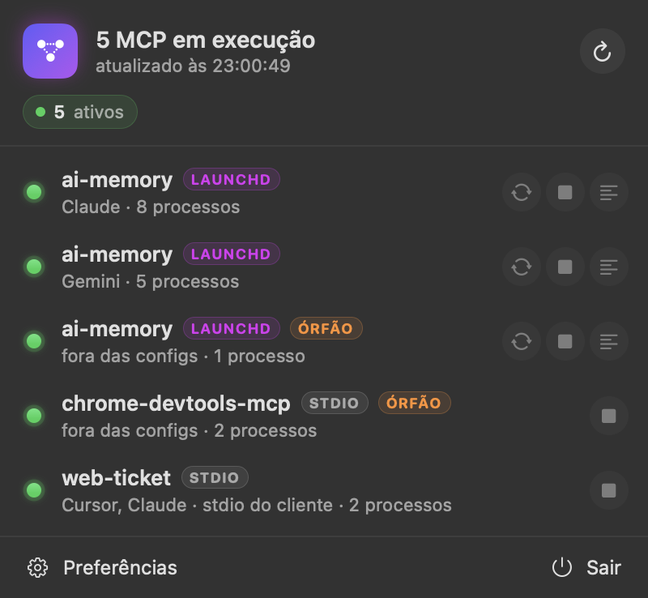

# MCP Indicator para macOS

Versão nativa (Swift/SwiftUI) do MCP Indicator para a barra de menus do macOS em Apple Silicon. Faz o mesmo que a extensão GNOME: mostra os servidores [MCP](https://modelcontextprotocol.io/) configurados e em execução neste Mac.



## O que aparece

- Glifo na barra de menus com um ponto de estado (verde: há MCP vivo; amarelo: algum degradado) e, opcionalmente, quantos estão em execução
- Clique esquerdo abre o popover; clique direito abre um menu curto (Atualizar, Preferências, Sair)
- Por MCP: estado, origens (Cursor, Claude…), tipo (`STDIO`, `HTTP`, `SSE`, `LAUNCHD`) e ações: reiniciar, parar, iniciar, logs, copiar URL
- Menu de contexto na linha: copiar nome/comando/URL/PIDs, mostrar a config ou o LaunchAgent no Finder
- Notificação quando um MCP HTTP/LaunchAgent local passa de ok para degradado ou parado

## Diferenças para a versão GNOME

| GNOME / Linux | macOS |
| --- | --- |
| `/proc/<pid>/cmdline` | `sysctl(KERN_PROC_UID)` + `KERN_PROCARGS2` |
| unit `systemctl --user` | LaunchAgent em `~/Library/LaunchAgents` (`launchctl bootstrap/kickstart/bootout`) |
| `journalctl --user -u` | últimas linhas de `StandardErrorPath` / `StandardOutPath` do plist |
| GSettings | `UserDefaults` (`io.github.rodriguesfas.mcp-indicator`) |
| `~/.config/Code/User/mcp.json` | `~/Library/Application Support/Code/User/mcp.json` |
| `~/.config/Claude/claude_desktop_config.json` | `~/Library/Application Support/Claude/claude_desktop_config.json` |

Parar um MCP com LaunchAgent usa `bootout` (com `KeepAlive` um `kill` seria desfeito pelo launchd); iniciar faz `bootstrap` de novo.

A associação MCP → LaunchAgent é pelo label (`com.exemplo.ai-memory` casa com `ai-memory`), pelo comando, por argumentos distintivos ou pela porta HTTP.

## Compilar e instalar

Precisa de macOS 13+ e das Command Line Tools (`xcode-select --install`). O Xcode é opcional.

```bash
cd macos
./build.sh            # gera build/MCP Indicator.app (arm64, assinatura ad-hoc)
./build.sh --install  # copia para ~/Applications e abre
./build.sh --dmg      # gera build/MCP-Indicator-<versão>-arm64.dmg para distribuir
```

O `.dmg` abre numa janela própria (fundo de `scripts/make-dmg-background.swift`, ícones de 128 pt, seta da app para Aplicações e ícone do volume): basta arrastar uma para a outra. O layout é aplicado pelo Finder via AppleScript; na primeira vez o macOS pede permissão de Automação para o Terminal controlar o Finder. Sem ela o `.dmg` é gerado na mesma, só que sem a janela personalizada.

Como a assinatura é ad-hoc (sem Developer ID nem notarização), num Mac que baixou o `.dmg` o Gatekeeper bloqueia a primeira abertura: clique direito na app → *Abrir*, ou Ajustes do Sistema → Privacidade e Segurança → *Abrir mesmo assim*.

Para abrir ao iniciar sessão: Preferências → *Abrir ao iniciar sessão* (usa `SMAppService`).

## Desenvolvimento

```bash
swift run MCPIndicator           # corre a app a partir do código
swift run MCPIndicator --dump    # imprime a varredura no terminal
swift run MCPIndicator --snapshot /tmp/shots   # renderiza popover e ícone (claro/escuro) para PNG
./test.sh                        # testes (swift-testing)
```

Estrutura em `Sources/MCPIndicator`:

- `Detector.swift`: configs, merge entre clientes, heurísticas de processos (port de `detector.js`)
- `Processes.swift`: tabela de processos do utilizador via `sysctl`
- `Health.swift`: classificação, sonda TCP e handshake `initialize` (port de `health.js`)
- `Launchd.swift`, `Control.swift`: LaunchAgents e ações (port de `control.js`)
- `Monitor.swift`: estado observável, refresh periódico, notificações
- `StatusBarController.swift`, `MenuView.swift`, `SettingsView.swift`: interface

Notas do toolchain, só com as Command Line Tools no SDK do macOS 27:

- `@State` é uma macro cujo plugin vem só com o Xcode; o código usa `@ViewState` (em `Theme.swift`), um wrapper sobre `State` que compila nos dois casos
- o plugin de macros do swift-testing às vezes não é encontrado em builds incrementais; `./test.sh` repete do zero quando isso acontece

## Limites

Os mesmos da extensão GNOME: casar processo é heurística, stdio só existe enquanto o cliente o mantém, e HTTP remoto entra como "remoto" sem sonda (salvo se ligar isso nas Preferências).
